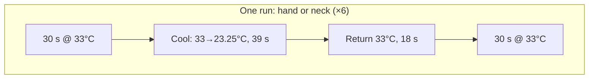
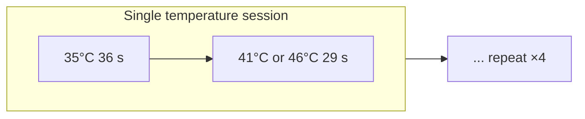
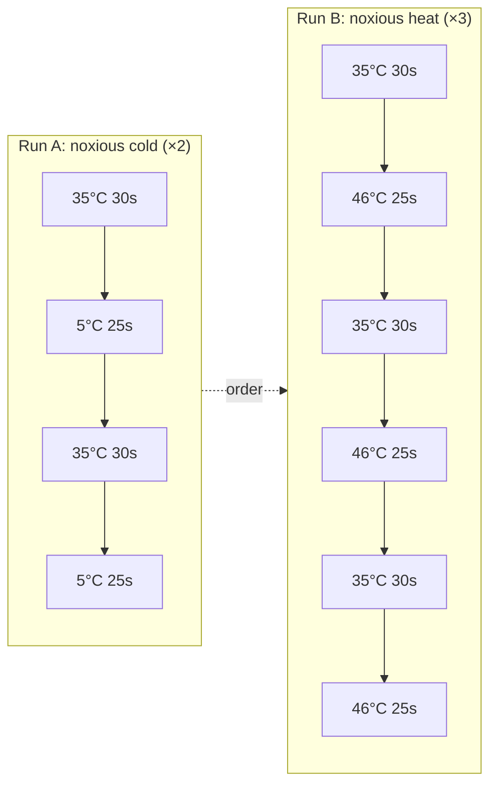
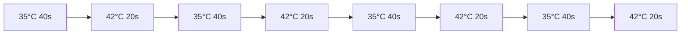
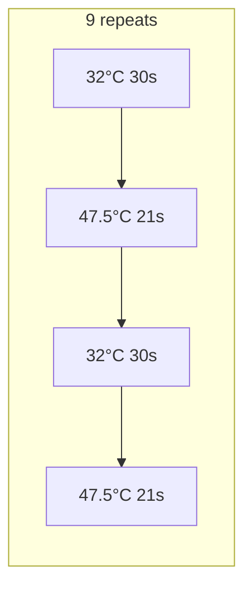
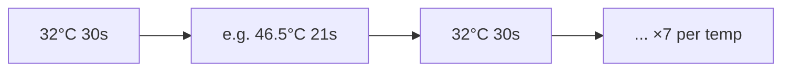

# Temperature / thermal stimulation fMRI: paradigm report

> **Source:** Zotero library + primary Methods sections (Hua, Asad, Ye, Becerra, Tracey).  
> **Scope:** Non-human primate and human BOLD fMRI with contact thermodes or related thermal delivery.

---

## 1. At-a-glance comparison

| Study | Species | Stimulus | Thermode / device | Key temperatures | Epoch structure |
|--------|---------|----------|-------------------|-----------------|-----------------|
| **Hua et al. 2005** | Human | **Innocuous cooling ramp** (hand + neck) | Medoc TSA-II (30×30 mm hand, 16×16 mm neck) | 33 → 23.25°C @ 0.25°C/s, baseline 33°C | 6 ramps/run; 30 s baseline between ramps; foot brush control between hand/neck runs |
| **Becerra et al. 1999** | Human | **Warm vs noxious heat** | Medoc Peltier ~3×3 cm, MRI-adapted | 41 vs 46°C, baseline 35°C | 36 s baseline, 29 s plateaus; 4 stims; two separate runs (41°C first, then 46°C) |
| **Tracey et al. 2000** | Human | **Noxious hot vs cold** (separate runs) | Medoc 3×3 cm | 46°C hot, 5°C cold, baseline 35°C | 30 s baseline, 25 s noxious; 3 cycles heat, 2 cycles cold; cold before heat |
| **Asad et al. 2016** | Cynomolgus (NHP) | **Innocuous warm after capsaicin** (forearm) + tail assay | Medoc Pathway ATS 1.6×1.6 cm²; water bath (tail) | 35/42°C (fMRI); 42/48°C tail | 4× (20 s @ 42°C, 40 s @ 35°C); pre/post topical capsaicin patch 30 min |
| **Ye et al. 2021** | Squirrel monkey (NHP) | **Noxious / graded heat** (digits) | Medoc CHEPS 30×30 mm, 70°C/s | 32°C baseline; 38–47.5°C | **Mapping:** 9×(47.5°C 21 s, 32°C 30 s); **dose–response:** 7 blocks each of 4 temps (21 s) / 32°C 30 s |

---

## 2. Human: innocuous cooling (graded ramp) — Hua et al. 2005

**Target:** Somatotopy in **dorsal posterior insula (dpIns)**; dynamic cooling from **33°C** toward **~23.25°C** (hand and neck, separate runs). **fMRI:** 3 T, **TR 3 s**, 6 ramps per run.

**One cooling event (conceptual “trapezoid”):**

```text
 Temp
  33°C ───────────────────╮
         ╲  linear cool    │ return 33°C
          ╲ 0.25°C/s      │ @ 1°C/s
           ╲               │
            23.25°C ·····   (39 s ramp + 18 s return, then 30 s at 33°C baseline)
```

**Mermaid — sequence of blocks within one run (6 repeats):**



**Run order:** hand cooling run → **control:** foot brush 15 s ON / 15 s OFF → neck cooling run.

---

## 3. Human: warm vs noxious heat (plateau) — Becerra et al. 1999

**Design:** **35°C** baseline, then **29 s** at **41°C** (innocuous warm) *or* **46°C** (noxious), **4** repeats per temperature block; two sessions with **5 min** separation, **46°C** after **41°C** to limit sensitization. Thermode on **dorsum of left hand**, ~**9 cm²** active area; cue **30 s** before.



---

## 4. Human: noxious hot **vs** noxious cold (separate runs) — Tracey et al. 2000

**Device:** Medoc; **dorsum left hand**; phasic (trapezoid onset/offset, stats on **plateau**).

| Run | Noxious target | Cycles | Baseline | Noxious plateaus |
|-----|----------------|--------|----------|------------------|
| A (first) | **5°C** cold | 2 | 35°C, 30 s | 25 s each |
| B (second) | **46°C** heat | 3 | 35°C, 30 s | 25 s each |

**Peripheral timing (from paper):** ~**17 s** to reach **5°C** plateau; **~6 s** to **46°C**; offsets **~20 s** (cold) / **~11 s** (heat) — fMRI used **first block only** in some maps to limit habituation. **1.5 T**, **TR/TE 2500/70 ms**.



---

## 5. NHP: capsaicin + warm blocks — Asad et al. 2016

**fMRI (3 T):** **8** cynomolgus; isoflurane; **4 cycles**; **ON 20 s @ 42°C** / **OFF 40 s @ 35°C** on **palmar proximal forearm**; Medoc **Pathway**; same site **~30 min** **topical capsaicin 0.1 mg** (or vehicle) between runs. **Rationale in paper:** **42°C** as non-noxious warm in this context (vs noxious **~48°C** in tail test).

**ASCII timeline (one run):**

```text
 35°C         42°C         35°C         42°C
 |←  40 s  →|← 20 s →|←  40 s  →|← 20 s →|  ... 4 cycles
       OFF         ON         OFF         ON
```



---

## 6. NHP: graded / mapping heat (CHEPS) — Ye et al. 2021

**Setup:** **Squirrel monkeys**; 9.4 T; **CHEPS 30×30 mm** on **D2–D3**, **ramp 70°C/s**; isoflurane. **A)** “Mapping” — alternating **47.5°C 21 s** and **32°C 30 s**, **9** heat blocks. **B)** Dose–response — temps **38, 42, 46.5, 47.5°C** (each **21 s**), **32°C 30 s** between, **7** blocks per temperature. **Ephys** used **5 s** thermal on / **32°C 30 s** off, pseudorandom order.

**Mapping paradigm (simplified “square wave” view):**



**Graded (four temperatures) — one temperature channel:**



---

## 7. Design takeaways (for your own fMRI)

1. **Ramped innocuous cool** (Hua): models **stimulus-locked graded BOLD**; needs **regressor = ramp** (not only boxcar) for dpIns.  
2. **Block heat/cold to baseline** (Becerra, Tracey, Asad, Ye): standard **GLM with HRF**; order effects matter (innocuous before noxious; cold before hot if same session).  
3. **NHP** choices: **sensitization** (Asad, warm only + capsaicin) **vs** **max contrast chemosensory heat** (Ye, high ramp rate, ~noxious plateaus on glabrous skin).  
4. **Hardware:** Medoc family (**TSA-II**, **Pathway/ATS**, **CHEPS**) appears repeatedly — **ramp rate**, **footprint**, and **body site** co-determine “noxious” vs “warm” for a given **°C**.

---

## 8. Zotero item keys (this library)

- Hua 2005: `2K5RJ8MJ` (dup `RLA8AAQ7`)  
- Becerra 1999: `ADFXQ46F`  
- Tracey 2000: `CH2VYCR7`  
- Asad 2016: `XE58RIRL` (dup `BLZX5SIB`)  
- Ye 2021: `ZV9FT66F`

---

*Document generated for project `projectome_analysis` — methods reference only; cite originals for publication.*
