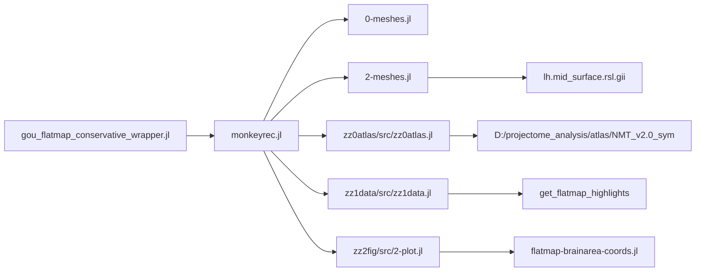

# Gou Flatmap Key Dependencies

## Goal
Illustrate the minimum dependency chain for a conservative Julia wrapper that reuses Gou's original flatmap code with local file-path substitution.

## Core Dependency Flow

## Key Files
- `references/analysis-code_gou_etal_2025/monkeyrec/monkeyrec.jl`
  - Bootstraps packages and includes `0-meshes.jl`, `2-meshes.jl`, and imports `zz0atlas`, `zz1data`, `zz2fig`.
- `references/analysis-code_gou_etal_2025/monkeyrec/0-meshes.jl`
  - Core mesh operations: `dijkstra_vertex`, `clip_mesh`, `find_boundary`, `flatten_mesh`, `refine_mesh`, `sample_mesh`.
- `references/analysis-code_gou_etal_2025/monkeyrec/2-meshes.jl`
  - Original flatmap setup logic: surface load, clipping presets, `mesh_annotate_vert`.
- `references/analysis-code_gou_etal_2025/monkeyrec/zz0atlas/src/zz0atlas.jl`
  - Atlas loaders and NMT hierarchy mapping. In the conservative wrapper, only `NmtDat.load_images()` is path-swapped.
- `references/analysis-code_gou_etal_2025/monkeyrec/zz1data/src/zz1data.jl`
  - `cached_result`, `get_flatmap_highlights`.
- `references/analysis-code_gou_etal_2025/monkeyrec/zz2fig/src/2-plot.jl`
  - Original rendering functions: `plot_flatmap_base!`, `plot_flatmap_soma!`.
- `references/analysis-code_gou_etal_2025/monkeyrec/monkeytemp/wyz-upload/julia/flatmap-brainarea-coords.jl`
  - Manual label placement used by `plot_flatmap_base!`.

## Local Files Used As Replacements
- `atlas/NMT_v2.0_sym/NMT_v2.0_sym/NMT_v2.0_sym_SS.nii.gz`
- `atlas/NMT_v2.0_sym/NMT_v2.0_sym/NMT_v2.0_sym_segmentation.nii.gz`
- `atlas/NMT_v2.0_sym/NMT_v2.0_sym/CHARM_in_NMT_v2.0_sym.nii.gz`
- `atlas/NMT_v2.0_sym/NMT_v2.0_sym/SARM_in_NMT_v2.0_sym.nii.gz`
- `atlas/NMT_v2.0_sym/NMT_v2.0_sym/supplemental_masks/NMT_v2.0_sym_cerebellum_mask.nii.gz`
- `atlas/NMT_v2.0_sym/tables_CHARM/CHARM_key_all.txt`
- `atlas/NMT_v2.0_sym/tables_SARM/SARM_key_all.txt`
- `atlas/NMT_v2.0_sym/NMT_v2.0_sym_surfaces/lh.mid_surface.rsl.gii`

## Conservative Wrapper Strategy
- Keep Gou plotting and mesh logic unchanged where possible.
- Replace only atlas-loading paths and surface-loading entry point.
- Use original `plot_flatmap_base!` and `plot_flatmap_soma!` directly.
- Avoid hand-redrawing style in Python unless Julia fails completely.
